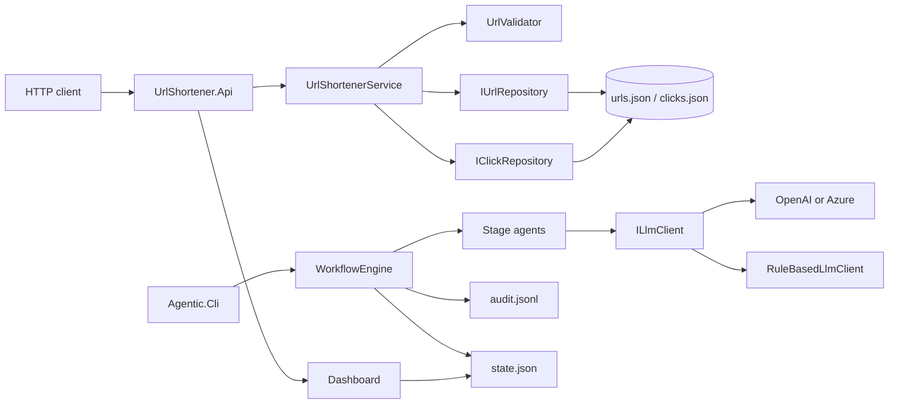
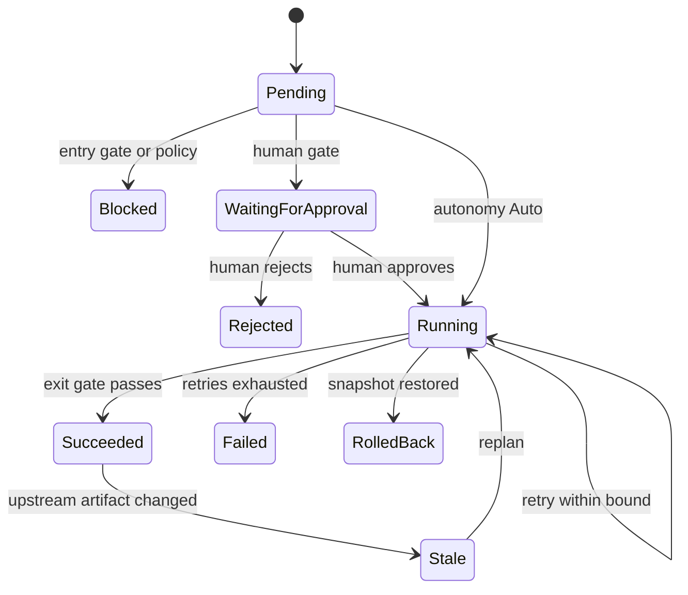
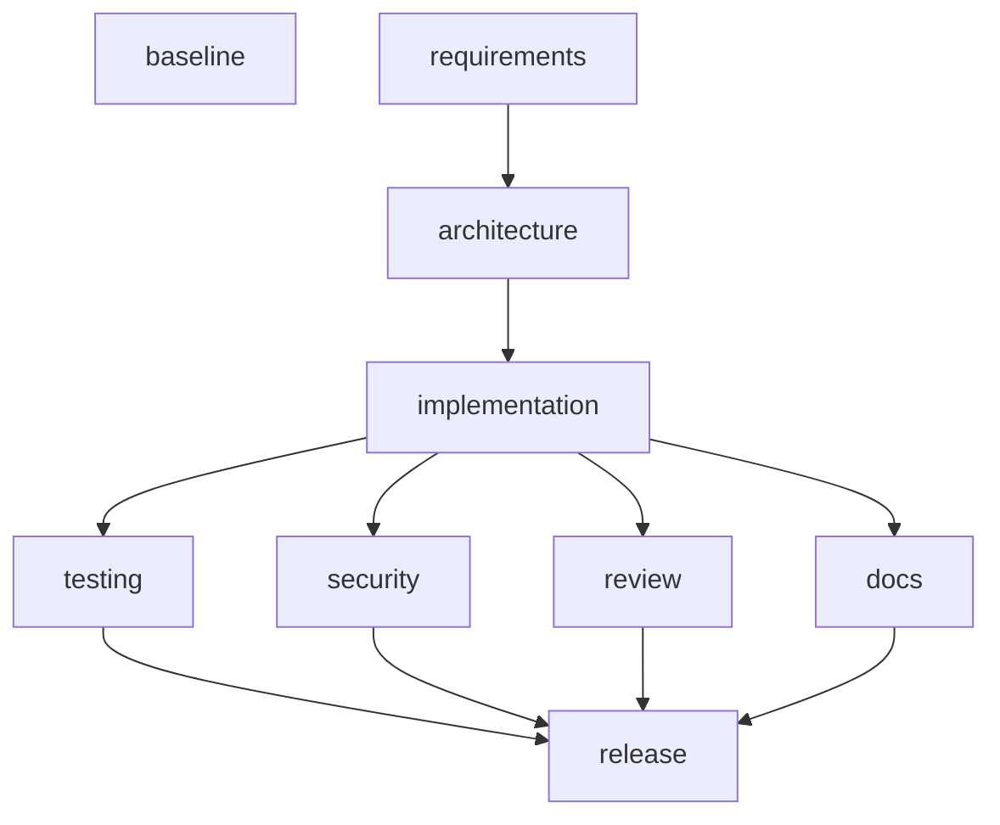

# Architecture

## Components

The product and the orchestrator are separate processes. They share the repo only as files: the API serves `runs/`, the CLI writes `runs/`.

| Piece | Responsibility |
| --- | --- |
| `UrlShortener.Core` | Mappings, clicks, validation, the application service, repository interfaces. No I/O. |
| `UrlShortener.Infrastructure` | JSON documents, `SemaphoreSlim`, atomic temp-file replace. |
| `UrlShortener.Api` | Endpoints, rate limiter, Swagger, dashboard, approval HTTP API. |
| `Agentic.Orchestrator` | DAG, gates, policy, audit, metrics, replanner, agents, LLM clients. |
| `Agentic.Cli` | Scenario commands and the console approval prompt. |

## Orchestration model

A scenario file is a `WorkflowDefinition`: nodes, `dependsOn`, autonomy, approval timing, retry bound, allow-listed write paths, and an optional replan. `GraphValidator` rejects cycles, duplicate ids, and missing dependencies, then produces a stable topological order.

`WorkflowEngine.ExecuteLoopAsync` is the only place that changes stage status.

1. Stop if a `STOP` file exists, the step budget is spent, or the duration budget is spent. State is saved.
2. Walk the topological order. A pending node becomes ready only when every dependency succeeded and its entry gate passes. A rejected, blocked, or rolled-back dependency marks descendants the same way and does not execute them.
3. Run the whole ready set with `Task.WhenAll`. That is the parallel path. A later node that lists several dependencies is the join: it is not ready until every one has succeeded.
4. Each node may require approval before it runs (`HumanRequired` / `AutoWithReview`, timing `before`) or after it produces evidence (timing `after`, used for release and for the ambiguous requirement).
5. The agent returns a `StageResult`. The engine writes the artifact, hashes it, and appends the audit event. The agent does not set the next status.
6. On failure the classifier chooses retry, rollback, or safe-stop. Retries use exponential backoff and pass the previous error back in `FailureFeedback`. Security and governance failures are not retried. Exhausting retries on a stage with `rollback: true` restores the pre-stage workspace snapshot.
7. After the batch, a scenario replan can replace one upstream artifact and mark only its transitive dependents `Stale`.

## Control flow for the demo DAGs

Greenfield and ambiguous:

`baseline` has no dependency. It runs beside requirements and is not invalidated when the requirement text changes. Brownfield inserts `analysis` (a real scan of `src/UrlShortener.*`) between requirements and architecture.

## Policy and artifacts

- Writes go through `Workspace`, which calls `PolicyEngine`. Absolute paths, `..`, and prefixes outside the stage allow-list are denied. The stage becomes `Blocked` and is not retried.
- After a writing stage, `SecurityScanner` reads workspace source files. `Process.Start` / `System.Diagnostics.Process` is HIGH. A hardcoded secret pattern is CRITICAL. Either one fails the security gate with no retry.
- Security and review stages are `readOnly` and have an empty allow-list.
- Decision records are `{ id, stage, actor, what, why, inputsHash, parentDecisionId }` and live on the run state. The audit log is a separate hash chain: each line stores `prevHash` and `hash = SHA256(prevHash + payload)`. `audit verify` recomputes the chain.
- Metrics (`runs/<id>/metrics.json`) include success rate, retry count and rate, rollback count and frequency, MTTR, per-stage latency, approval wait, and end-to-end latency. MTTR is the mean time from a stage's first failed attempt to its later success. It is null when nothing recovered.

## Decisions

**ADR-1. A custom orchestrator, not an agent framework, owns the workflow.** Frameworks hide the scheduler. This assignment is graded on an explicit DAG, gates, and audit. `WorkflowEngine` is small enough to read in an interview and is the only writer of status transitions.

**ADR-2. JSON files behind `IUrlRepository` / `IClickRepository`.** The user asked for a file store instead of a database. The API depends on the interfaces, so a later EF Core implementation can replace `JsonUrlRepository` without changing endpoints. Atomicity is temp file + `File.Replace`, under one `SemaphoreSlim`, so concurrent creates cannot drop a row and a crash before replace leaves the previous document.

**ADR-3. Deterministic LLM fallback.** A missing key, timeout, or HTTP 5xx must not strand a demo. `FallbackLlmClient` calls the configured provider when a key exists and otherwise (or on failure) calls `RuleBasedLlmClient`. Fallback is an audit event, not a silent success.

**ADR-4. Agents write a workspace copy, not the shipping API.** `runs/<id>/workspace` is the sandbox. The shipping shortener stays stable so `dotnet test` remains the quality gate. The brownfield analyst still reads the real source.

**ADR-5. No DNS lookup on redirect.** Resolving a hostname would be a network call on the hot path and its own SSRF tool. Validation blocks IP literals and well-known local names. That gap is documented in `docs/RISKS_AND_TRADEOFFS.md`.

**ADR-6. File snapshots instead of git checkpoints.** Rollback has to work in a folder that may not be a git repo, and the demo must not create commits the user did not ask for. The snapshot is taken before the stage attempts and restored if retries are exhausted.

**ADR-7. Release readiness is computed, not asked of the model.** `ReleaseAgent` sets `ready` from dependency status. The model may add a narrative. It cannot flip a failed test to go.
