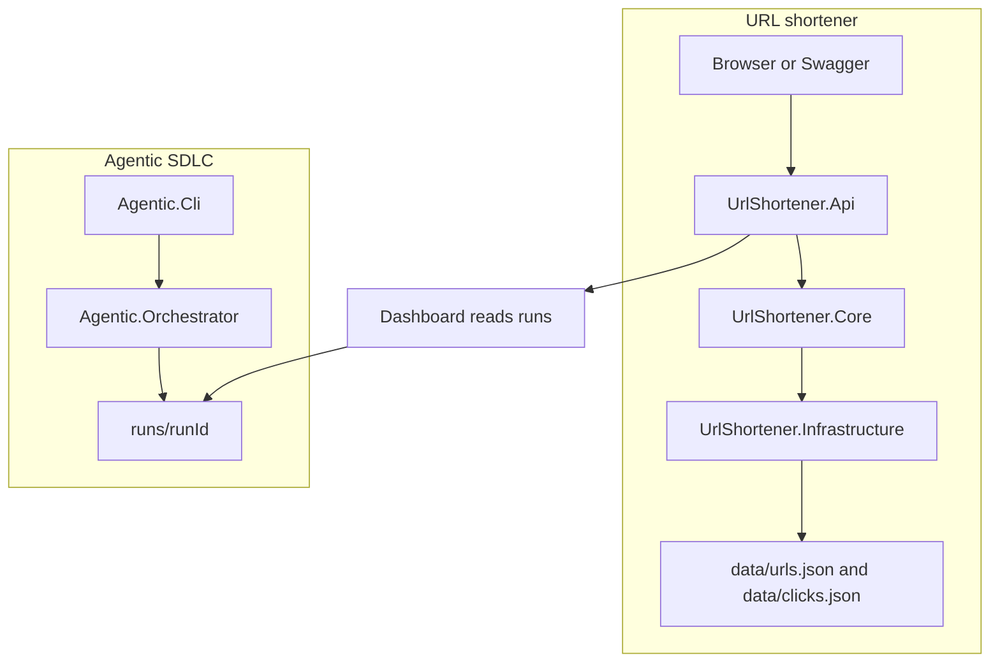

# URL Shortener Agentic SDLC — Demo and Test Guide

Share this document with the interview panel. It explains the architecture, how to run the application, how to test every API, and how to demonstrate greenfield, brownfield, and ambiguous agent workflows.

Base URL: `http://localhost:5080`

Project folder:

```powershell
cd "$HOME\OneDrive - Zelis Healthcare\Desktop\AgenticAi\UrlShortener.Agentic"
```

## 1. Objective

The prototype has two products in one solution:

1. **URL shortener.** Create a short code, redirect a browser, record clicks, and read analytics. Data is stored in JSON files.
2. **Agentic SDLC orchestrator.** Take a written requirement and run it through requirements, design, implementation, testing, security, review, documentation, and release. Agents execute. Humans approve high-impact steps.

The shortener is the subject. The orchestrator is the main interview demonstration.

## 2. Where it fits

| Use | Example |
|---|---|
| Product | Campaign links, SMS links, QR codes, and click analytics |
| Engineering system | A governed path from a requirement to reviewable artifacts, tests, an audit log, and a release decision |
| Regulated environment | AI proposes changes inside a sandbox. Humans approve them. Every action is traceable |

## 3. Architecture



### Product request flow

1. `POST /api/shorten` validates the destination URL.
2. Core creates a code or returns the existing code for the same URL.
3. Infrastructure writes `data/urls.json` under a lock. The write is atomic: a temp file is written, then replaced.
4. A browser visit to `GET /{code}` records a click in `data/clicks.json` and returns `302`.
5. Swagger's **Try it out** does not follow that redirect. It receives JSON instead, so an external site cannot cause a CORS failure.
6. `GET /api/stats/{code}` reads the stored clicks.

### Agent workflow

Greenfield:

```text
Baseline and Requirements
        |
   Architecture          <-- human approval
        |
  Implementation          <-- human approval
        |
 Testing + Security + Review + Docs     <-- these four run together
        |
     Release              <-- human approval after the join
```

Brownfield inserts one extra stage:

```text
Requirements -> Codebase impact analysis -> Architecture -> Implementation
```

The Codebase Analyst reads the existing `src/UrlShortener.*` projects and writes an impact report before design starts.

### Governance controls

| Control | What it does |
|---|---|
| Dependency graph | A stage starts only after every stage it depends on has succeeded |
| Entry and exit gates | A stage can be blocked before it starts, or failed after its output is checked |
| Human approval | Requirements, architecture, implementation, and release can wait for a person |
| Bounded retry | A failed stage retries only up to `maxRetries` |
| Rollback | Implementation restores its workspace snapshot if retries are exhausted |
| Safe stop | `stop` writes a `STOP` file. The run pauses between stages and can be resumed |
| Policy | Agents may write only inside the paths allowed for that stage |
| Audit | `audit.jsonl` is append-only and hash-chained |
| Metrics | Success rate, retries, rollbacks, recovery time, and stage duration |
| Re-plan | A changed upstream output reruns only the stages that depend on it |
| LLM fallback | If no API key is configured, agents use deterministic rules so the demo still runs |

Agents write under `runs/<runId>/workspace`. They do not replace the application source in `src/`. A human reviews the proposal before promoting it.

## 4. Projects and folders

Open `UrlShortener.Agentic.sln` in Visual Studio.

| Project | Type | Responsibility | How to run it |
|---|---|---|---|
| **UrlShortener.Core** | Class library | Models, URL safety rules, shorten/redirect/stats rules, repository interfaces | Cannot be started. It is used by the API and tests |
| **UrlShortener.Infrastructure** | Class library | Locked, atomic JSON storage for URLs and clicks | Cannot be started. Used by the API |
| **UrlShortener.Api** | Web app | HTTP API, Swagger, dashboard, approval endpoints | **Set this as the startup project and press F5** |
| **Agentic.Orchestrator** | Class library | Workflow engine, agents, policy, audit, metrics, rollback, re-plan | Cannot be started. The CLI and orchestrator tests use it |
| **Agentic.Cli** | Console app | Starts, resumes, stops, and inspects a scenario run | `dotnet run --project src/Agentic.Cli -- <command>` |
| **UrlShortener.Tests** | xUnit | API and storage tests | `dotnet test tests/UrlShortener.Tests` |
| **Agentic.Orchestrator.Tests** | xUnit | Workflow control tests | `dotnet test tests/Agentic.Orchestrator.Tests` |

Dependencies:

```text
UrlShortener.Api
  -> UrlShortener.Core
  -> UrlShortener.Infrastructure -> UrlShortener.Core

Agentic.Cli
  -> Agentic.Orchestrator

UrlShortener.Tests
  -> UrlShortener.Api and its dependencies

Agentic.Orchestrator.Tests
  -> Agentic.Orchestrator
```

| Folder | Purpose |
|---|---|
| `scenarios/` | Input JSON for a greenfield, brownfield, or ambiguous request |
| `prompts/` | Standing instructions for each agent. Do not put a feature request here |
| `data/` | The shortener's JSON database: `urls.json` and `clicks.json` |
| `runs/` | One folder per orchestration run: state, audit, metrics, and agent output |
| `docs/` | Architecture, scenarios, testing notes, and this guide |

## 5. Start the application

### Visual Studio

1. Open `UrlShortener.Agentic.sln`.
2. Right-click **UrlShortener.Api** and choose **Set as Startup Project**.
3. Select the **http** launch profile.
4. Press **F5**.

The browser opens:

- Swagger: `http://localhost:5080/swagger`
- Dashboard: `http://localhost:5080/dashboard`
- Health: `http://localhost:5080/health`

### Terminal

```powershell
dotnet run --project src/UrlShortener.Api
```

`dotnet run` does not open a browser. Open `http://localhost:5080/swagger` yourself.

Prerequisite: .NET SDK 10. The solution pins SDK `10.0.401` in `global.json`, with roll-forward inside the .NET 10 feature band.

## 6. API reference

`{code}` is the short identifier returned by `POST /api/shorten`. Pass `google-demo` or `Nu7Cnk1`. Do not pass the full URL or `http://localhost:5080/google-demo`.

There is no API that lists every short URL. Open `data/urls.json` to see the stored links.

### 6.1 Health

Use: confirm the process is running.

```http
GET /health
```

```powershell
Invoke-RestMethod http://localhost:5080/health
```

```json
{ "status": "Healthy" }
```

Status: `200`.

### 6.2 Readiness

Use: confirm the JSON data directory can be written.

```http
GET /health/ready
```

```json
{ "status": "Ready" }
```

If the directory cannot be written, the status is `503`:

```json
{ "status": "NotReady", "error": "..." }
```

### 6.3 Create a short URL

Use: turn a long destination into a short code for a campaign, SMS message, or QR code.

Swagger: **POST /api/shorten** → **Try it out**.

```http
POST /api/shorten
Content-Type: application/json

{
  "url": "https://www.google.com",
  "customAlias": "google-demo",
  "expiresInDays": 30
}
```

```powershell
$body = @{
  url = "https://www.google.com"
  customAlias = "google-demo"
  expiresInDays = 30
} | ConvertTo-Json

Invoke-RestMethod http://localhost:5080/api/shorten `
  -Method Post -ContentType "application/json" -Body $body
```

`201 Created`:

```json
{
  "code": "google-demo",
  "shortUrl": "/google-demo",
  "originalUrl": "https://www.google.com",
  "expiresAtUtc": "2026-11-09T00:00:00Z",
  "created": true
}
```

| Field | Required | Meaning |
|---|---|---|
| `url` | Yes | Absolute `http` or `https` destination |
| `customAlias` | No | Your own code. Omit it to receive a generated code |
| `expiresInDays` | No | Days until the link returns `410` |

| Result | Status | Body code |
|---|---|---|
| New link | 201 | response field `created: true` |
| Same URL already stored | 200 | `created: false`, same `code` |
| Invalid or unsafe URL | 400 | `invalid-request` |
| Alias already used by a different URL | 409 | `alias-conflict` |
| More than 60 calls from one IP in 60 seconds | 429 | `rate-limited` |

Error shape:

```json
{
  "error": "Custom alias is already in use.",
  "code": "alias-conflict",
  "status": 409
}
```

### 6.4 Open a short URL

Use: send a person to the original website and count the visit.

Browser address bar:

```text
http://localhost:5080/google-demo
```

Expected: `302 Found` and `Location: https://www.google.com`. This records one click.

Swagger **Try it out** on **GET /{code}** is a preview. It returns JSON and does not record a click:

```json
{
  "code": "google-demo",
  "originalUrl": "https://www.google.com",
  "shortUrl": "/google-demo",
  "status": "Active",
  "expiresAtUtc": "2026-11-09T00:00:00Z"
}
```

The API detects Swagger because the browser sends `Sec-Fetch-Mode: cors` or `Sec-Fetch-Dest: empty`. A normal page navigation sends `Sec-Fetch-Mode: navigate` and is redirected.

| Result | Status | Body |
|---|---|---|
| Unknown, deleted, or malformed code | 404 | `Short URL was not found.` / `missing-code` |
| Expired link | 410 | `Short URL has expired.` / `expired` |
| Stored destination is not absolute http or https | 400 | `invalid-destination` |
| Rate limit exceeded | 429 | `rate-limited`, plus `Retry-After` |

A code is malformed when it is blank, contains a dot, or is shorter than 3 or longer than 32 characters.

PowerShell, without following the redirect:

```powershell
$r = Invoke-WebRequest http://localhost:5080/google-demo `
  -MaximumRedirection 0 -SkipHttpErrorCheck
$r.StatusCode
$r.Headers.Location
```

### 6.5 Read statistics

Use: show how many times the short link was opened, by day and by referrer.

```http
GET /api/stats/google-demo
```

In Swagger, enter only `google-demo` in the `code` field.

```json
{
  "code": "google-demo",
  "originalUrl": "https://www.google.com",
  "totalClicks": 3,
  "clicksPerDay": [
    { "day": "2026-10-10", "clicks": 3 }
  ],
  "topReferrers": [
    { "referrer": "(direct)", "clicks": 3 }
  ]
}
```

Unknown code: `404` with `missing-code`.

Stats count browser redirects only. A Swagger preview does not increase `totalClicks`.

### 6.6 Delete a short URL

Use: retire a campaign link without physically removing its stored record.

```http
DELETE /api/urls/google-demo
```

Success: `204 No Content` and an empty body.

After deletion, redirect and stats return:

```json
{
  "error": "Short URL was not found.",
  "code": "missing-code",
  "status": 404
}
```

The record remains in `data/urls.json` with a deleted marker. This is a soft delete.

### 6.7 List orchestration runs

Use: show every agent run on the dashboard. This does not create a run.

```http
GET /api/runs
```

```json
[
  {
    "runId": "20261010083352-864f2293",
    "name": "Greenfield URL shortener",
    "status": "Completed",
    "scenarioType": "greenfield",
    "stages": [
      { "id": "requirements", "status": "Succeeded" }
    ]
  }
]
```

### 6.8 Run detail, audit, and metrics

```http
GET /api/runs/{runId}
GET /api/runs/{runId}/audit
GET /api/runs/{runId}/metrics
```

| Route | Use | Missing run |
|---|---|---|
| `/api/runs/{runId}` | Full stage state, decisions, and output hashes | `404 Run not found.` |
| `/api/runs/{runId}/audit` | Ordered hash-chained events | `404 Audit log not found.` |
| `/api/runs/{runId}/metrics` | Success rate, retries, rollbacks, MTTR, latency | `404 Metrics not found.` |

PowerShell:

```powershell
$runId = "20261010083352-864f2293"
Invoke-RestMethod "http://localhost:5080/api/runs/$runId"
Invoke-RestMethod "http://localhost:5080/api/runs/$runId/audit"
Invoke-RestMethod "http://localhost:5080/api/runs/$runId/metrics"
```

Replace the sample run ID with the ID printed by the CLI.

### 6.9 Approvals

Use: approve or reject a paused high-impact stage from the dashboard.

```http
GET /api/approvals
```

Empty result when nothing is waiting:

```json
[]
```

Approve:

```http
POST /api/approvals/{runId}
Content-Type: application/json

{
  "decision": "approve",
  "comment": "Reviewed and approved"
}
```

```json
{ "runId": "20261010083352-864f2293", "decision": "approve" }
```

Use `"decision": "reject"` to stop the workflow. Any other value returns `400`. If that run is not waiting, the result is `404` with `No pending approval for that run.`

The dashboard sends this request when you click **Approve** or **Reject**. It refreshes every 2 seconds.

### 6.10 Pages

| Route | Result |
|---|---|
| `GET /` | `302` to `/dashboard` |
| `GET /dashboard` | Run list, stage status, audit, metrics, and approval buttons |
| `GET /favicon.ico` | `204` |

Every API response includes `X-Correlation-Id`.

## 7. API test scenarios

Start **UrlShortener.Api** before these manual tests. Use a new alias if `google-demo` already exists.

### TS-01 Create a custom short URL

1. In Swagger, execute **POST /api/shorten** with the body in section 6.3.
2. Expected: `201`, `"code": "google-demo"`, `"created": true`.
3. Open `data/urls.json` and confirm the record is present.

### TS-02 Create a generated code

1. Send only `{ "url": "https://example.com/generated-demo" }`.
2. Expected: `201` and a generated `code` such as `Nu7Cnk1`.
3. Save that code. It is the value for redirect, stats, and delete.

### TS-03 Shorten the same URL again

1. Repeat the request from TS-02.
2. Expected: `200`, the same `code`, and `"created": false`.

### TS-04 Alias already taken

1. Send `customAlias` `google-demo` with a different `url`, such as `https://example.com/other`.
2. Expected: `409`.

```json
{
  "error": "Custom alias is already in use.",
  "code": "alias-conflict",
  "status": 409
}
```

### TS-05 Reject an unsafe scheme

1. Send `{ "url": "javascript:alert(1)" }`.
2. Expected: `400` and `"code": "invalid-request"`.

### TS-06 Reject a private or loopback destination

1. Send `{ "url": "http://127.0.0.1/admin" }`.
2. Also try `http://localhost/admin` and `http://192.168.1.10/`.
3. Expected: `400` and `"code": "invalid-request"`.
4. Talking point: this blocks a short link from being used to reach an internal address.

### TS-07 Browser redirect

1. Paste `http://localhost:5080/google-demo` into the address bar.
2. Expected: the browser lands on `https://www.google.com`.
3. Repeat twice more, for three visits in total.

### TS-08 Swagger preview of the same code

1. In Swagger, execute **GET /{code}** with `google-demo`.
2. Expected: `200` JSON with `"status": "Active"` and `originalUrl`.
3. Expected: no CORS error and no navigation to Google.
4. This call does not add a click.

### TS-09 Statistics after three browser visits

1. Execute **GET /api/stats/{code}** with `google-demo`.
2. Expected: `200` and `"totalClicks": 3`.
3. `clicksPerDay` contains today's date. A direct browser visit has referrer `(direct)`.

### TS-10 Unknown code

1. Execute **GET /api/stats/does-not-exist**.
2. Execute **GET /does-not-exist** in Swagger.
3. Execute **DELETE /api/urls/does-not-exist**.
4. Expected for each: `404`.

```json
{
  "error": "Short URL was not found.",
  "code": "missing-code",
  "status": 404
}
```

### TS-11 Expired link

`expiresInDays` must be from 1 to 3650. A negative value returns `400`, so it cannot create an already-expired link.

1. Create a link with `"expiresInDays": 1` and a unique alias such as `expires-demo`.
2. Stop the API so it is not writing the file.
3. In `data/urls.json`, set that record's `expiresAtUtc` to a past UTC time, such as `2020-01-01T00:00:00Z`.
4. Start the API again.
5. Open the code in the browser and in Swagger.
6. Expected: `410`.

```json
{
  "error": "Short URL has expired.",
  "code": "expired",
  "status": 410
}
```

Confirm the exact expiry input against `UrlShortenerService` before the live demo. The automated test TC-06 covers the `410` result.

### TS-12 Soft delete

1. Execute **DELETE /api/urls/google-demo**.
2. Expected: `204`.
3. Open `http://localhost:5080/google-demo` again.
4. Expected: `404` and `missing-code`.
5. The row remains in `data/urls.json` as deleted.

### TS-13 Health and readiness

1. Open `/health` and `/health/ready`.
2. Expected: `Healthy` and `Ready`.

### TS-14 Automated reliability cases

Do not perform these manually during a short demo. They are covered by `UrlShortener.Tests`:

| Test | Proves |
|---|---|
| TC-09 | 100 concurrent shorten calls do not lose writes or corrupt JSON |
| TC-10 | A failed write leaves the previous JSON file intact |
| TC-11 | The 61st request from one client in the window returns `429` |

## 8. How to submit a greenfield or brownfield request

You do not type the request into Swagger. You put it in a scenario JSON file and run **Agentic.Cli**. That command creates the `runId`.

### Use the prepared scenarios

```powershell
dotnet run --project src/Agentic.Cli -- run scenarios/greenfield.json
dotnet run --project src/Agentic.Cli -- run scenarios/brownfield.json
dotnet run --project src/Agentic.Cli -- run scenarios/ambiguous.json
```

Add `--auto-approve` when you do not want the console to wait for approval.

### Add your own feature request

Copy the closest file. Change `id`, `name`, and `requirement`. Leave the `stages` array unchanged.

Greenfield means a new system:

```powershell
Copy-Item scenarios/greenfield.json scenarios/qr-service.json
```

```json
"requirement": "Build a QR-code service that accepts an absolute http or https URL, returns a PNG, rejects unsafe URLs, and exposes health and readiness endpoints."
```

Brownfield means a change to this existing shortener. Keep the `analysis` stage that uses `CodebaseAnalystAgent`.

```powershell
Copy-Item scenarios/brownfield.json scenarios/list-urls.json
```

```json
"requirement": "Add GET /api/urls to the existing URL shortener. Support page and pageSize, hide soft-deleted links by default, preserve the current JSON format, and add tests. Do not break shorten, redirect, stats, or delete."
```

Run it:

```powershell
dotnet run --project src/Agentic.Cli -- run scenarios/list-urls.json
```

The files in `prompts/` are standing agent instructions, such as "return JSON and list ambiguities." They are loaded automatically. Do not paste the feature request into those files.

## 9. What each scenario demonstrates

### Greenfield — `scenarios/greenfield.json`

Requirement: build a URL shortener with creation, redirect, analytics, validation, collision-safe codes, and health.

Stages:

| Order | Stage | Agent | Starts after |
|---|---|---|---|
| 1 | Governance baseline | BaselineAgent | Nothing |
| 1 | Requirements | RequirementsAgent | Nothing; approval before it continues |
| 2 | Architecture | ArchitectAgent | Requirements; human approval |
| 3 | Implementation | DeveloperAgent | Architecture; human approval; rollback enabled |
| 4 | Testing, Security, Review, Docs | Test, Security, Review, Docs agents | Implementation; these four run together |
| 5 | Release | ReleaseAgent | All four validation stages; approval after the result |

What to open afterward:

| File | What it shows |
|---|---|
| `runs/<runId>/workspace/requirements/requirements.json` | Normalized requirements, assumptions, ambiguities, acceptance criteria |
| `runs/<runId>/workspace/architecture/architecture.json` | Components, decisions, and task breakdown |
| `runs/<runId>/workspace/src/IMPLEMENTATION.md` | Sandboxed implementation proposal |
| `runs/<runId>/workspace/tests/acceptance-notes.md` | Test result |
| `runs/<runId>/workspace/docs/CHANGELOG.md` | Run-scoped changelog |
| `runs/<runId>/workspace/release/readiness.json` | Go or no-go release report |
| `runs/<runId>/state.json` | Stage status and decision lineage |
| `runs/<runId>/audit.jsonl` | Hash-chained event log |
| `runs/<runId>/metrics.json` | Reliability numbers |
| `runs/<runId>/summary.md` | Short completion summary |

### Brownfield — `scenarios/brownfield.json`

Requirement: add custom aliases and link expiry to the existing shortener, and fix duplicate-code collision, without breaking redirect or analytics.

The extra stage is **Codebase impact**. Its output is:

```text
runs/<runId>/workspace/analysis/impact.json
```

Show this file to the panel. It identifies affected projects, APIs, data flow, and risk before architecture starts. Architecture depends on this analysis, not only on the raw requirement.

### Ambiguous — `scenarios/ambiguous.json`

Requirement: "Make links secure and fast."

The Requirements Agent must surface the ambiguity instead of inventing silent rules. The scenario then supplies an approved interpretation:

- Security means `http` and `https` only, no `javascript:`, no localhost or private IPs, per-IP `429`, and no raw IP addresses in logs.
- Speed means p95 redirect under 50 ms from an in-process JSON lookup, without the API fetching the destination.

After that interpretation is applied, architecture and its downstream stages run again. Baseline does not need to run again. This is the re-plan demonstration.

## 10. Orchestrator test steps

Keep the API running in one terminal so the dashboard can refresh. Run the CLI in a second terminal.

### OS-01 Happy-path greenfield

```powershell
dotnet run --project src/Agentic.Cli -- run scenarios/greenfield.json --auto-approve
```

1. Copy the printed run ID.
2. Expected: baseline, requirements, architecture, and implementation succeed.
3. Expected: testing, security, review, and docs overlap in time.
4. Expected: release succeeds only after those four finish.
5. Expected final status: `Completed`.
6. Open `http://localhost:5080/dashboard` and select the run.

### OS-02 Human approval

```powershell
dotnet run --project src/Agentic.Cli -- run scenarios/greenfield.json
```

1. The CLI pauses before a high-impact stage.
2. The dashboard shows the pending approval within about 2 seconds.
3. Click **Approve**, or answer in the console.
4. Expected: the next stage starts.
5. Run it again and click **Reject**.
6. Expected: status becomes rejected and later stages do not run.

Approval request, if you prefer PowerShell:

```powershell
$decision = @{ decision = "approve"; comment = "Reviewed in demo" } | ConvertTo-Json
Invoke-RestMethod "http://localhost:5080/api/approvals/$runId" `
  -Method Post -ContentType "application/json" -Body $decision
```

### OS-03 Brownfield impact

```powershell
dotnet run --project src/Agentic.Cli -- run scenarios/brownfield.json --auto-approve
```

1. Expected: an `analysis` stage appears that was not in the greenfield run.
2. Open `workspace/analysis/impact.json`.
3. Talking point: the agent reads the current system before proposing a change.

### OS-04 Retry and rollback

```powershell
dotnet run --project src/Agentic.Cli -- run scenarios/brownfield.json --auto-approve --inject-failure implementation
```

1. Expected: implementation fails, retries within its limit of 2, then rolls back.
2. Expected: testing, security, review, docs, and release do not succeed.
3. Expected: the injected workspace file is removed by the snapshot restore.
4. Dashboard and `metrics.json` show the retry and rollback counts.

### OS-05 Audit and metrics

```powershell
dotnet run --project src/Agentic.Cli -- audit verify <runId>
dotnet run --project src/Agentic.Cli -- metrics <runId>
```

1. Expected audit result: `AUDIT OK`.
2. To show tamper detection, duplicate one line inside `runs/<runId>/audit.jsonl`, run `audit verify` again, then restore the file.
3. Expected after the edit: verification fails because the hash chain no longer matches.
4. Metrics include success rate, retry count, rollback count, MTTR, and per-stage latency.

### OS-06 Safe stop and resume

1. Start a run without `--auto-approve` so it pauses, or start one and immediately stop it from another terminal:

```powershell
dotnet run --project src/Agentic.Cli -- stop <runId>
```

2. Expected: a `runs/<runId>/STOP` file exists and the run reaches a safe-stopped state between stages.
3. Resume it:

```powershell
dotnet run --project src/Agentic.Cli -- resume <runId> --auto-approve
```

4. A long stage that has already started, such as `dotnet test`, finishes before the stop is noticed. The check happens between stages.

### OS-07 No LLM key

1. Do not set `OPENAI_API_KEY` or Azure OpenAI variables.
2. Run any scenario.
3. Expected console line: no API key, using the deterministic fallback.
4. Expected: the run still completes.
5. Optional live model: set `OPENAI_API_KEY` and `OPENAI_MODEL`, or the `AZURE_OPENAI_*` variables from the README. Never put a key in source or in a scenario file.

### OS-08 Ambiguous request and re-plan

```powershell
dotnet run --project src/Agentic.Cli -- run scenarios/ambiguous.json --auto-approve
```

1. Open `workspace/requirements/requirements.json` and show the ambiguity list.
2. Show that architecture was executed again after the approved interpretation.
3. Show that an unaffected earlier stage was not repeated.
4. Talking point: a changed decision invalidates dependent work only.

## 11. Automated tests

From the project folder:

```powershell
dotnet build
dotnet test
dotnet test tests/UrlShortener.Tests/UrlShortener.Tests.csproj
dotnet test tests/Agentic.Orchestrator.Tests/Agentic.Orchestrator.Tests.csproj
```

In Visual Studio: **Test** → **Test Explorer** → **Run All Tests**.

### URL shortener tests

| Test | Expected result |
|---|---|
| TC-01 | Valid `https` URL returns `201` and a code |
| TC-02 | `javascript:` is rejected |
| TC-03 | `127.0.0.1` is rejected |
| TC-04 | Browser-style redirect returns `302` and `Location` |
| Swagger fetch test | Active link returns `200` JSON and no `Location` |
| TC-05 | Unknown redirect returns `404` |
| Unknown stats | `404` JSON `missing-code` |
| Unknown delete | `404` JSON `missing-code` |
| Unknown preview | Swagger-style fetch of an unknown code returns `404` JSON |
| TC-06 | Expired link returns `410` |
| TC-07 | Taken alias returns `409` |
| TC-08 | Three clicks produce `totalClicks` 3 |
| TC-09 | 100 concurrent shortens keep valid JSON and lose no writes |
| TC-10 | A failed atomic write leaves the previous file intact |
| TC-11 | Excess calls return `429` |
| TC-12 | The same URL twice returns the same code |
| Soft delete | Redirect after delete returns `404` |
| Validator tests | Unsafe destinations are blocked and public `https` is allowed |

### Orchestrator tests

| Test | Expected result |
|---|---|
| OC-01 | A cyclic stage graph is rejected |
| OC-02 | A stage with an unmet entry gate stays blocked |
| OC-03 | Two failures then success records two retries and MTTR |
| OC-04 | Retry exhaustion restores the snapshot |
| OC-05 | Rejecting design prevents downstream stages |
| OC-06 | A write outside the allowed path is blocked |
| OC-07 | Dangerous generated code fails the security gate |
| OC-08 | A changed requirement reruns only downstream stages |
| OC-09 | A `STOP` file safe-stops the run and it can resume |
| OC-10 | A tampered audit log fails verification |
| OC-11 | An unavailable LLM falls back and the run completes |
| OC-12 | Parallel stages overlap and the join waits for all of them |

## 12. Fifteen-minute demo script

| Time | Do this | Say this |
|---|---|---|
| 0:00 | Open the solution and name the seven projects | "The API is the product. The CLI starts the engineering workflow. The orchestrator is a library, so it is not a startup project." |
| 0:02 | F5 on **UrlShortener.Api** | "Swagger opens because the http profile launches the browser at `/swagger`." |
| 0:03 | TS-01, then open the short URL in the address bar | "The code from the create response is the only value required by redirect, stats, and delete." |
| 0:05 | Swagger **GET /{code}**, then stats | "Swagger receives JSON so it does not follow the redirect to Google. A real browser still redirects and records the click." |
| 0:07 | Show `404` for `does-not-exist` | "Missing data returns a stable JSON error, not an empty failure or a stack trace." |
| 0:08 | Open `/dashboard` | "This page only reads runs. It does not submit a new requirement." |
| 0:09 | Run greenfield without `--auto-approve` | "The CLI creates the run ID. Agents stop at human gates." |
| 0:11 | Approve in the dashboard | "Agents execute. A person owns the high-impact decision." |
| 0:13 | Run brownfield with `--auto-approve` and open `impact.json` | "Brownfield first identifies the existing modules and data flow." |
| 0:14 | Show `audit verify` and metrics | "The hash chain makes a changed audit detectable. Metrics show retries, rollback, and duration." |
| 0:15 | Mention the injected-failure command | "If implementation cannot recover, its snapshot is restored and later stages do not run." |

If time remains, run:

```powershell
dotnet test
```

## 13. Run folder map

```text
runs/<runId>/
├── state.json                 Current stage status and decisions
├── audit.jsonl                Hash-chained events
├── metrics.json               Reliability metrics
├── summary.md                 Completion summary
├── STOP                       Present only while a safe stop is requested
├── artifacts/                 Latest text output of each stage
├── snapshots/                 Files saved before a stage writes
└── workspace/
    ├── baseline/
    ├── requirements/requirements.json
    ├── analysis/impact.json   Brownfield only
    ├── architecture/architecture.json
    ├── src/IMPLEMENTATION.md
    ├── tests/acceptance-notes.md
    ├── docs/CHANGELOG.md
    └── release/readiness.json
```

## 14. Troubleshooting

| Symptom | Cause and fix |
|---|---|
| "Class library cannot be started" | Startup project is Core, Infrastructure, or Orchestrator. Set **UrlShortener.Api**. |
| CLI prints help and exits | **Agentic.Cli** was started with no arguments. Use the `run` command, or set its debug arguments to `run scenarios/greenfield.json --auto-approve`. |
| Browser does not open | The selected profile does not have browser launch enabled, or you used `dotnet run`. Open `http://localhost:5080/swagger`. |
| Swagger says CORS / Failed to fetch on **GET /{code}** | The old process is still running and is returning `302`. Stop debugging and press F5 again. A current build returns JSON to Swagger. Test the real redirect from the address bar. |
| Port 5080 is in use | Stop the previous **UrlShortener.Api** debug session before starting another. |
| MSB3027, DLL locked | The API process is still running. Press Shift+F5, then rebuild. |
| NETSDK1045 or net10.0 is unsupported | Install the .NET 10 SDK and use a Visual Studio version that supports it. |
| Scenario not found | Run the command from the project folder, or pass the full path to the JSON file. |
| Dashboard has no runs | The CLI has not completed a scenario yet. `GET /api/runs` only lists `runs/` folders. |
| No LLM response quality | No key is configured. The demo is using the deterministic fallback, which is expected. |

## 15. Limitations to state before the panel asks

- JSON storage is for one machine and moderate writes. Repositories are interfaces, so SQL can replace the JSON implementation later.
- Agent output stays in the run workspace. It is not automatically copied into `src/`.
- `DocsAgent` writes `runs/<runId>/workspace/docs/CHANGELOG.md`. It does not update `README.md` or this guide.
- The security scan looks for dangerous patterns in text. It is not a full static-analysis product.
- Dashboard approval is local and has no login. It is a demo control, not a production identity system.
- Safe stop is checked between stages, not in the middle of a running test command.
- There is no product endpoint yet for listing all short URLs.
- There is no HTTP endpoint that starts a scenario. The CLI is the entry point.

## 16. Short answers for the panel

**Why a custom orchestrator?** Every gate, approval, retry, rollback, and audit event is visible code with a test. The behavior is not hidden inside a framework.

**Why JSON instead of SQL?** The assignment demo must run with no database install. The repository interface keeps that choice reversible.

**Why a fallback model?** A demo must finish when no API key or network model is available. A configured OpenAI or Azure OpenAI client is used when credentials exist.

**What is controlled autonomy?** Agents can execute allowed steps and write only to allowed folders. Humans approve high-impact stages and decide whether a proposal is promoted.

**Greenfield or brownfield?** A new system is greenfield. A change to the existing shortener is brownfield, even when the change is a new endpoint, because the current code and stored data must keep working.

## 17. Demo checklist

- [ ] Startup project is **UrlShortener.Api**, profile **http**.
- [ ] `http://localhost:5080/swagger` opens.
- [ ] Create, browser redirect, Swagger preview, stats, unknown-code `404`, and delete all work.
- [ ] `data/urls.json` changes when a link is created.
- [ ] Dashboard opens at `/dashboard`.
- [ ] Greenfield run creates a new `runs/<runId>/` folder.
- [ ] Approval is shown once without `--auto-approve`.
- [ ] Brownfield run has `workspace/analysis/impact.json`.
- [ ] `audit verify <runId>` prints `AUDIT OK`.
- [ ] `dotnet test` has been run before the interview.

## Related documents

- [Architecture](ARCHITECTURE.md)
- [Scenarios](SCENARIOS.md)
- [Testing](TESTING.md)
- [Risks and trade-offs](RISKS_AND_TRADEOFFS.md)
- [Engineering summary](ENGINEERING_SUMMARY.md)
